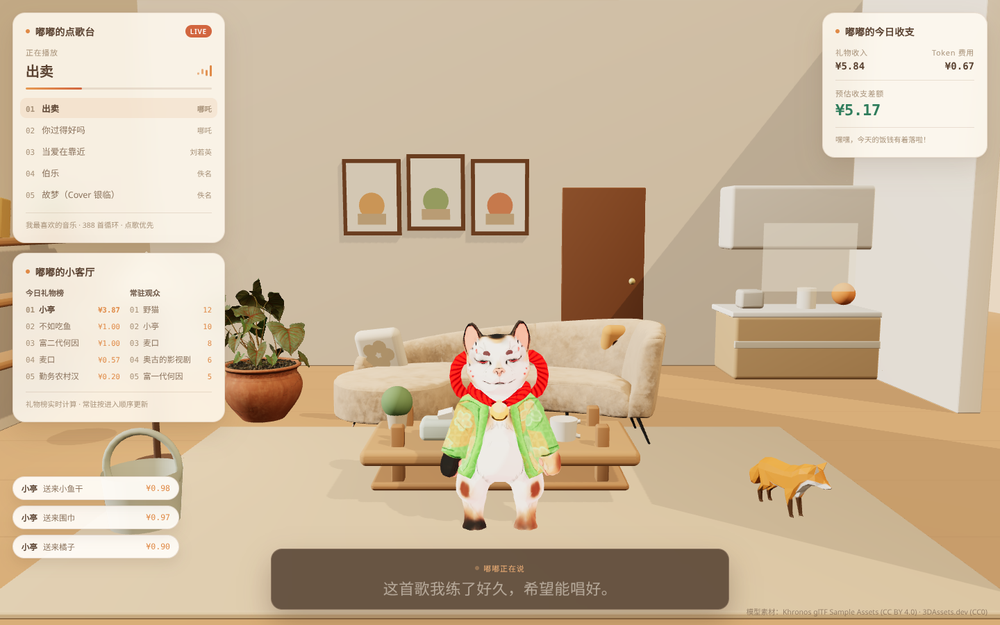

# 嘟嘟的 3D 直播间（原型）

一个用浏览器实时渲染的 3D 虚拟直播间原型：暖色调的客厅场景、一个会眨眼、会挥手、会说话的猫系主播，以及叠加在画面上的点歌台、礼物榜、收支账单和实时字幕条。

全部跑在 Web 端，不依赖引擎导出包。首屏加载 5 个模型（约 14 MB，其中 VRM 角色 4.9 MB），其余家具和场景都是代码拼出来的几何体。



 

## 技术栈

| 层 | 选型 | 说明 |
|---|---|---|
| 构建 | Vite 7 + TypeScript | 开发态 HMR，生产构建产物 gzip 后约 600 KB |
| 渲染 | Three.js + React Three Fiber + drei | 场景树用 JSX 描述，灯光/材质可直接改 props |
| 状态 | Zustand | 单 store 承载直播房间状态 |
| 角色 | @pixiv/three-vrm 3 | 加载 VRM 人形，提供 Humanoid 骨骼、表情预设和 spring bone 物理 |
| UI | 原生 HTML/CSS 浮层 | 卡片不进 3D 场景，用绝对定位盖在 canvas 上 |
| 模型 | glTF/GLB + VRM | Khronos 示例场景 + CC0 虚拟形象 |

没有用 Unity WebGL 或 Unreal 像素流：这个场景是静态室内 + 单角色，Web 原生渲染的包体和迭代速度都更划算。

## 快速开始

要求 Node ≥ 20。

```bash
npm install
npm run dev      # http://localhost:5173
npm run build    # 产物在 dist/
npm run preview
```

## 目录结构

```
public/models/          沙发 / 绿植 / 狐狸 + 主播 VRM
src/App.tsx             画布配置、相机、色调映射、事件循环
src/scene/Scene.tsx     房间、家具、灯光、相机漂移
src/scene/VrmMascot.tsx VRM 主播（骨骼待机 / 挥手 / 眨眼 / 口型）
src/scene/Asset.tsx     glTF 加载与包围盒归一化工具
src/scene/Fox.tsx       带骨骼动画的小狐狸
src/ui/Overlay.tsx      四块 HTML 浮层
src/data/live.ts        直播状态的模拟事件源
src/styles.css          全部界面样式
```

## 场景是怎么搭的

**房间与家具**：墙面、地板、门、厨房、相框、茶几、地毯、抱枕全部用 `RoundedBox` 和基础几何体拼成。地板接缝用细长条叠加，避免额外贴图。

**角色**：`public/models/TwoTails.vrm` 是 CC0 的 VRM 人形角色，标准 Humanoid 骨架 + 表情预设 + spring bone。加载后按包围盒统一缩放到 1.5 m，脚底对齐地面。动画全部在 `useFrame` 里用归一化骨骼实时计算：

- 待机：脊柱、胸腔、头部做低频正弦摇摆，像呼吸和轻微晃动
- 挥手：随机触发 1.8 秒，右大臂抬到水平以上并摆动
- 眨眼：每 2–5 秒把 `blink` 表情打到 1，持续 0.14 秒
- 口型：`speaking` 为真时驱动 VRM 的 `aa` 表情预设，嘴型跟着正弦波开合
- 视线：把 `vrm.lookAt.target` 指向相机，眼睛会跟着镜头

注意 VRM 归一化骨骼的静止姿势是 T-pose，手臂水平伸展，直接设 `rotation.z = 0` 会让角色一直张着手，要绕 Z 轴压到 ±1.32 rad 才是自然垂放。另外不同 VRM 导出时单位不一定是 1:1 米制，必须按包围盒归一化。

**开源模型**：`Asset.tsx` 会读模型的包围盒，按目标尺寸等比缩放、水平居中、底面贴地，所以不用关心每个模型的单位和原点。沙发加载后按网格名把 `fabric` 材质重染成暖米色，并关掉模型自带的 `Key Light`，统一由场景灯光负责照明。

**光照**：一盏带阴影的暖色主光 + 一盏冷调补光 + 半球光，再用 drei 的 `Lightformer` 造一个低成本环境反射。这样能接近参考图里那种柔和的室内光，同时不用开实时全局光照。

**浮层**：canvas 铺满视口，四张卡片用 `position: absolute` 定位，毛玻璃、圆角、进度条全部走 CSS。这是这套方案最重要的取舍——UI 不进 3D，排版和交互成本直接降到普通前端水平。

## 接入真实数据

`src/data/live.ts` 里目前是一个 `setInterval` 驱动的模拟器，每 1.2 秒跑一次 `tick`：随机产生礼物、推进播放进度、换歌曲、换字幕。

换成真实后端时保留 store 结构，把 `tick` 替换成 WebSocket 消息处理即可：

```ts
socket.onmessage = (e) => {
  const msg = JSON.parse(e.data)
  if (msg.type === 'gift') useLive.getState().onGift(msg.payload)
  if (msg.type === 'subtitle') useLive.getState().setSpeech(msg.text)
}
```

口型驱动也留了接口：`speaking` 布尔值接 TTS 的播放状态，如果要更精细，可以把音素的振幅或 viseme 直接映射到 VRM 的 `aa` / `ih` / `ou` 表情预设。

## 模型与授权

| 文件 | 来源 | 授权 |
|---|---|---|
| `Sofa.glb` | Khronos glTF Sample Assets, *GlamVelvetSofa* | CC BY 4.0 |
| `Plant.glb` | Khronos glTF Sample Assets | CC BY 4.0 |
| `Fox.glb` | Khronos glTF Sample Assets | CC BY 4.0 |
| `TwoTails.vrm` | [Polygonal Mind · 100 Avatars](https://vtubeme.com/free-vrm-avatars)，由 VTubeMe 分发 | CC0 1.0（无需署名） |

署名信息同时显示在页面右下角。用于商业项目时请保留该署名，或替换为自有模型。

## 已知限制

- 没有做资源预加载和按需加载，场景在弱网下会先出现空白再整体出现
- 角色 VRM 有 4.9 MB，弱网下会比其他模型晚出现；后续建议先加载低模占位再替换
- 移动端尚未专门优化，中低端设备的像素比和阴影配置需要下调
- 狐狸模型的 `Survey` 动画只做了淡入播放，没有和玩家交互联动
- 光照未烘焙，如果要接近参考图的质感，建议在 Blender 里烘 lightmap 后替换实时阴影

## 下一步

- [ ] 把模拟数据换成真实 WebSocket 房间服务
- [ ] 接入 TTS，用 viseme 驱动口型
- [ ] 沙发/背景做 lightmap 烘焙，降低移动端开销
- [ ] 增加礼物特效（粒子、飘屏）
- [ ] 角色换装与表情状态机
